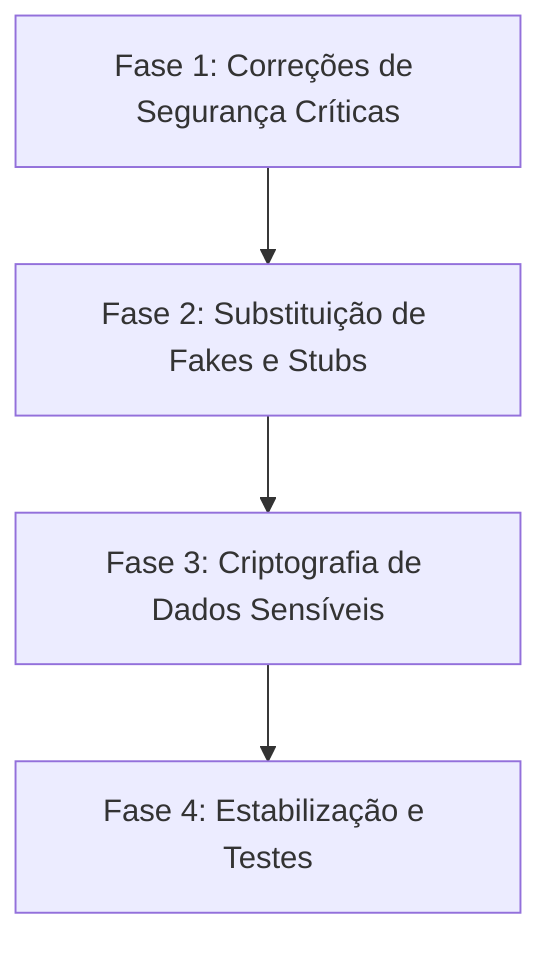

# Plano de Auditoria e Diagnóstico Téchnico - VYKnifeSwiss

> **Data da Auditoria:** 06 de Agosto de 2026  
> **Repositório / App:** `VYKnifeSwiss` (Canivete Suíço de Redes para Android)  
> **Tecnologias:** Android Native, Kotlin, Jetpack Compose, Coroutines, Room, OkHttp, JSch  
> **Status Geral do Projeto:** ⚠️ **Requer Atenção Imediata (Risco Alto de Segurança e Recursos Incompletos)**

---

## 1. Resumo Executivo

O **VYKnifeSwiss** é um aplicativo Android multifuncional focado em ferramentas de rede local (Chat P2P, Servidor FTP/WebDAV, Scanner de Sub-rede/Portas, SpeedTest, Terminal SSH, Cofre de Senhas, Autenticador TOTP, etc.).

A auditoria identificou que, embora o aplicativo possua uma interface gráfica moderna e ampla gama de recursos, existem **vulnerabilidades críticas de segurança** que expõem o dispositivo e os dados do usuário na rede local, bem como **funcionalidades mockadas ou incompletas** que simulam comportamentos sem executar a lógica real.

---

## 2. Matriz de Riscos e Problemas Encontrados

| ID | Categoria | Severidade | Descrição Sucinta | Componente Afetado |
|---|---|---|---|---|
| **SEC-01** | Segurança | 🚨 **Crítica** | Vulnerabilidade de Path Traversal nos Servidores FTP e WebDAV | [FTPServer.kt](file:///projetos/apps-mobile/android/VYKnifeSwiss/app/src/main/java/com/example/ui/screens/FTPServer.kt#L127-L136), [WebDAVServer.kt](file:///projetos/apps-mobile/android/VYKnifeSwiss/app/src/main/java/com/example/ui/screens/WebDAVServer.kt#L101-L104) |
| **SEC-02** | Segurança | 🚨 **Crítica** | Servidores FTP, WebDAV e HTTP expostos sem qualquer autenticação | [FTPServer.kt](file:///projetos/apps-mobile/android/VYKnifeSwiss/app/src/main/java/com/example/ui/screens/FTPServer.kt#L111-L114), [WebDAVServer.kt](file:///projetos/apps-mobile/android/VYKnifeSwiss/app/src/main/java/com/example/ui/screens/WebDAVServer.kt#L107-L192), [InternalHttpFileServer.kt](file:///projetos/apps-mobile/android/VYKnifeSwiss/app/src/main/java/com/example/service/InternalHttpFileServer.kt#L74-L88) |
| **SEC-03** | Segurança | 🚨 **Crítica** | Transmissão não criptografada da Área de Transferência (Clipboard) via P2P | [LocalChatService.kt](file:///projetos/apps-mobile/android/VYKnifeSwiss/app/src/main/java/com/example/service/LocalChatService.kt#L677-L703) |
| **SEC-04** | Segurança | 🔴 **Alta** | Armazenamento de credenciais SSH e Tokens OAuth2 em texto puro nas SharedPreferences | [TerminalScreen.kt](file:///projetos/apps-mobile/android/VYKnifeSwiss/app/src/main/java/com/example/ui/screens/TerminalScreen.kt#L224-L229), [CloudSyncManager.kt](file:///projetos/apps-mobile/android/VYKnifeSwiss/app/src/main/java/com/example/ui/screens/CloudSyncManager.kt#L67-L111) |
| **SEC-05** | Segurança | 🔴 **Alta** | Desabilitação de `StrictHostKeyChecking` no cliente SSH | [TerminalScreen.kt](file:///projetos/apps-mobile/android/VYKnifeSwiss/app/src/main/java/com/example/ui/screens/TerminalScreen.kt#L79-L80) |
| **SEC-06** | Segurança | 🟡 **Média** | `usesCleartextTraffic="true"` ativo globalmente e Keystore debug commitada | [AndroidManifest.xml](file:///projetos/apps-mobile/android/VYKnifeSwiss/app/src/main/AndroidManifest.xml#L50), `debug.keystore` |
| **SEC-07** | Segurança | 🟡 **Média** | Fallback silencioso de segredos TOTP em texto puro ao falhar KeyStore | [TotpSecretCrypto.kt](file:///projetos/apps-mobile/android/VYKnifeSwiss/app/src/main/java/com/example/utils/TotpSecretCrypto.kt#L58-L61) |
| **FUNC-01** | Funcionalidade | ❌ **Mock/Fake** | SpeedTest gera valores aleatórios (`random()`) e hardcode de servidor/provedor | [SpeedTestScreen.kt](file:///projetos/apps-mobile/android/VYKnifeSwiss/app/src/main/java/com/example/ui/screens/SpeedTestScreen.kt#L341-L383), [SpeedTestUtils.kt](file:///projetos/apps-mobile/android/VYKnifeSwiss/app/src/main/java/com/example/utils/SpeedTestUtils.kt#L56-L84) |
| **FUNC-02** | Funcionalidade | ❌ **Mock/Fake** | Tela de controles da Rede Mesh altera apenas estado visual local em memória | [MeshInfoScreen.kt](file:///projetos/apps-mobile/android/VYKnifeSwiss/app/src/main/java/com/example/ui/screens/MeshInfoScreen.kt#L23-L24) |
| **FUNC-03** | Funcionalidade | ⚠️ **Stub** | Broadcast Receivers de SMS e MMS são stubs vazios | [SmsReceiver.kt](file:///projetos/apps-mobile/android/VYKnifeSwiss/app/src/main/java/com/example/receiver/SmsReceiver.kt#L9), [MmsReceiver.kt](file:///projetos/apps-mobile/android/VYKnifeSwiss/app/src/main/java/com/example/receiver/MmsReceiver.kt#L9) |
| **FUNC-04** | Funcionalidade | ⚠️ **Incompleta** | Tela de Notas exibe mensagem estática de funcionalidade pendente | [NotesScreen.kt](file:///projetos/apps-mobile/android/VYKnifeSwiss/app/src/main/java/com/example/ui/screens/NotesScreen.kt#L13) |
| **FUNC-05** | Funcionalidade | ⚠️ **Incompleta** | Sincronizador de Arquivos possui botões/switches sem ação | [FileSynchronizerScreen.kt](file:///projetos/apps-mobile/android/VYKnifeSwiss/app/src/main/java/com/example/ui/screens/FileSynchronizerScreen.kt#L39) |
| **FUNC-06** | Funcionalidade | ⚠️ **Incompleta** | Exclusão de arquivos no Google Drive não implementada | [GoogleDriveProvider.kt](file:///projetos/apps-mobile/android/VYKnifeSwiss/app/src/main/java/com/example/ui/screens/GoogleDriveProvider.kt#L92-L95) |
| **CODE-01** | Qualidade/Estabilidade | ⚠️ **Bug** | Corrupção de arquivos binários durante upload `PUT` no WebDAV | [WebDAVServer.kt](file:///projetos/apps-mobile/android/VYKnifeSwiss/app/src/main/java/com/example/ui/screens/WebDAVServer.kt#L147-L157) |
| **CODE-02** | Qualidade/Estabilidade | ⚠️ **Bug** | Concorrência sem thread-safety em listas e mapas compartilhados | [FTPServer.kt](file:///projetos/apps-mobile/android/VYKnifeSwiss/app/src/main/java/com/example/ui/screens/FTPServer.kt#L28), [InternalHttpFileServer.kt](file:///projetos/apps-mobile/android/VYKnifeSwiss/app/src/main/java/com/example/service/InternalHttpFileServer.kt#L14) |

---

## 3. Detalhamento dos Achados de Segurança

### 3.1. [SEC-01] Path Traversal nos Servidores FTP e WebDAV (Severidade: CRÍTICA)
- **Arquivo Afetado:** [FTPServer.kt](file:///projetos/apps-mobile/android/VYKnifeSwiss/app/src/main/java/com/example/ui/screens/FTPServer.kt#L127-L136) e [WebDAVServer.kt](file:///projetos/apps-mobile/android/VYKnifeSwiss/app/src/main/java/com/example/ui/screens/WebDAVServer.kt#L101-L104)
- **Descrição:**  
  No `FTPServer.kt`, comandos como `CWD /data/data/com.example/databases` ou `RETR /data/data/com.example/shared_prefs/vault_crypto_prefs.xml` constroem objetos `File(path)` diretamente a partir de um caminho absoluto fornecido pelo cliente. O servidor não valida se o caminho resultante está contido dentro do diretório base (`baseDir`).
  Da mesma forma, no `WebDAVServer.kt`, requisições com caminhos contendo `../` extrapolam a raiz da pasta base sem checagem de `canonicalPath`.
- **Impacto:** Um atacante na mesma rede Wi-Fi pode ler ou apagar arquivos privados do app (bancos de dados do Room, preferências de criptografia, segredos TOTP) e qualquer arquivo do armazenamento interno/externo do dispositivo.
- **Recomendação:** Implementar trava de diretório base (`canonicalPath.startsWith(baseDir.canonicalPath)`):
  ```kotlin
  val target = File(baseDir, path).canonicalFile
  if (!target.canonicalPath.startsWith(baseDir.canonicalPath)) {
      send("550 Access denied: Out of directory bounds")
      return
  }
  ```

---

### 3.2. [SEC-02] Ausência de Autenticação nos Servidores Locais (Severidade: CRÍTICA)
- **Arquivo Afetado:** [FTPServer.kt](file:///projetos/apps-mobile/android/VYKnifeSwiss/app/src/main/java/com/example/ui/screens/FTPServer.kt#L111-L114), [WebDAVServer.kt](file:///projetos/apps-mobile/android/VYKnifeSwiss/app/src/main/java/com/example/ui/screens/WebDAVServer.kt#L107-L192), [InternalHttpFileServer.kt](file:///projetos/apps-mobile/android/VYKnifeSwiss/app/src/main/java/com/example/service/InternalHttpFileServer.kt#L74-L88)
- **Descrição:**  
  - O `FTPServer` aceita qualquer usuário e senha (`PASS` valida incondicionalmente como `authenticated = true`).
  - O `WebDAVServer` aceita requisições HTTP anônimas sem checar cabeçalho `Authorization`.
  - O `InternalHttpFileServer` abre porta HTTP sem autenticação e não expira os tokens temporários após o download.
- **Impacto:** Qualquer pessoa conectada à mesma rede sem fio pode visualizar, baixar, modificar ou deletar arquivos mantidos no aparelho.
- **Recomendação:**
  1. Exigir usuário e senha configuráveis para FTP e HTTP Basic Auth para WebDAV.
  2. Adicionar suporte a conexões seguras (FTPS/HTTPS) ou vincular a escuta apenas ao endereço IP local com tokens descartáveis de uso único com TTL (Time-To-Live).

---

### 3.3. [SEC-03] Vazamento de Área de Transferência (Clipboard) via P2P (Severidade: CRÍTICA)
- **Arquivo Afetado:** [LocalChatService.kt](file:///projetos/apps-mobile/android/VYKnifeSwiss/app/src/main/java/com/example/service/LocalChatService.kt#L677-L703)
- **Descrição:**  
  O `LocalChatService` registra um `OnPrimaryClipChangedListener`. Sempre que o usuário copia qualquer texto no celular, o serviço automaticamente envia uma mensagem JSON `CLIPBOARD_SYNC` em texto puro via TCP para todos os pares descobertos na rede local.
- **Impacto:** Senhas copiadas de gerenciadores, códigos 2FA, chaves PIX ou textos confidenciais são transmitidos via broadcast/multicast em texto claro pela rede Wi-Fi.
- **Recomendação:**
  1. Adicionar uma opção de aceite explícito (opt-in) nas configurações com aviso de privacidade.
  2. Criptografar as mensagens do chat e clipboard usando chave simétrica derivada de um código de pareamento local.

---

### 3.4. [SEC-04] Armazenamento de Credenciais em Texto Puro (Severidade: ALTA)
- **Arquivo Afetado:** [TerminalScreen.kt](file:///projetos/apps-mobile/android/VYKnifeSwiss/app/src/main/java/com/example/ui/screens/TerminalScreen.kt#L224-L229) e [CloudSyncManager.kt](file:///projetos/apps-mobile/android/VYKnifeSwiss/app/src/main/java/com/example/ui/screens/CloudSyncManager.kt#L67-L111)
- **Descrição:**  
  - Senhas SSH e chaves privadas são salvas no formato `id;;name;;host;;port;;user;;authType;;secret` diretamente no arquivo XML das `SharedPreferences` (`ssh_profiles_pref.xml`).
  - Tokens de Acesso e Refresh de nuvens (Google Drive, OneDrive, Dropbox, pCloud) são salvos sem criptografia em `cloud_oauth_tokens.xml`.
- **Impacto:** Em dispositivos com acesso root ou via backups ADB, atacantes podem extrair credenciais de servidores remotos e contas de armazenamento em nuvem.
- **Recomendação:** Migrar a persistência dessas preferências sensíveis para `EncryptedSharedPreferences` (Jetpack Security / MasterKey no Android KeyStore).

---

### 3.5. [SEC-05] Desabilitação de `StrictHostKeyChecking` no SSH (Severidade: ALTA)
- **Arquivo Afetado:** [TerminalScreen.kt](file:///projetos/apps-mobile/android/VYKnifeSwiss/app/src/main/java/com/example/ui/screens/TerminalScreen.kt#L79-L80)
- **Descrição:**  
  A conexão SSH configura `config.put("StrictHostKeyChecking", "no")`, aceitando qualquer fingerprint de servidor sem validação.
- **Impacto:** Permite que atacantes realizem ataques Man-In-The-Middle (MITM) e interceptem o tráfego SSH e as senhas transmitidas.
- **Recomendação:** Permitir que o usuário visualize e aceite o fingerprint na primeira conexão (Trust-On-First-Use - TOFU) e salve o fingerprint confiável no app.

---

### 3.6. [SEC-06] `usesCleartextTraffic="true"` e Keystore em Repositório (Severidade: MÉDIA)
- **Arquivo Afetado:** [AndroidManifest.xml](file:///projetos/apps-mobile/android/VYKnifeSwiss/app/src/main/AndroidManifest.xml#L50), `debug.keystore` e `debug.keystore.base64`
- **Descrição:**  
  O atributo `android:usesCleartextTraffic="true"` autoriza tráfego HTTP desprotegido para todas as conexões da aplicação. Além disso, chaves de assinatura de debug estão salvas na raiz do projeto.
- **Recomendação:** Utilizar arquivo de configuração de segurança de rede (`network_security_config.xml`) liberando HTTP apenas para domínios ou IPs locais específicos. Remover a keystore e adicionar a extensão ao `.gitignore`.

---

## 4. Detalhamento de Funcionalidades Quebradas / Incompletas

### 4.1. [FUNC-01] SpeedTest Simulado com Gerador Aleatório (Fake)
- **Arquivo Afetado:** [SpeedTestScreen.kt](file:///projetos/apps-mobile/android/VYKnifeSwiss/app/src/main/java/com/example/ui/screens/SpeedTestScreen.kt#L341-L383) e [SpeedTestUtils.kt](file:///projetos/apps-mobile/android/VYKnifeSwiss/app/src/main/java/com/example/utils/SpeedTestUtils.kt#L56-L84)
- **Diagnóstico:**  
  - O teste de Ping executa `dummyPing += (10..18).random()`.
  - Caso o download real falhe ou seja lento, o app substitui a velocidade real por `(75..135).random().toFloat()`.
  - O Upload é inteiramente focado na fórmula `targetDownload * 0.35f + (3..7).random()`.
  - Servidor e Provedor são strings fixas (`"São Paulo, SP"`, `"Vivo S.A."`).
- **Ação:** Refatorar o `SpeedTestUtils` para utilizar conexões de teste via medição real por requisição HTTP multipart de upload e medição de tempo exata em socket, ou integração com biblioteca open-source de teste de vazão.

---

### 4.2. [FUNC-02] Tela de Configuração Mesh Desconectada do Módulo Real
- **Arquivo Afetado:** [MeshInfoScreen.kt](file:///projetos/apps-mobile/android/VYKnifeSwiss/app/src/main/java/com/example/ui/screens/MeshInfoScreen.kt#L23-L24)
- **Diagnóstico:**  
  A tela `MeshInfoScreen` possui interruptores para "Ativar Modo Mesh" e "Forçar Papel de Coordenador". Contudo, as alterações apenas modificam variáveis Compose locais (`remember { mutableStateOf }`). Nenhuma chamada é feita para as classes do módulo `mesh` (`MeshRouter`, `StoreAndForwardRepository`, `TransportManager`).
- **Ação:** Conectar os controles da UI ao serviço `LocalChatService` e à engine `MeshRouter`.

---

### 4.3. [FUNC-03 a FUNC-06] Telas de Stubs e Lógicas Incompletas
1. **SMS / MMS Stubs:** `SmsReceiver.kt`, `MmsReceiver.kt` e `HeadlessSmsSendService.kt` possuem implementações vazias. O app se declara manipulador padrão de SMS sem possuir a lógica de armazenamento no Room ou envio.
2. **NotesScreen:** [NotesScreen.kt](file:///projetos/apps-mobile/android/VYKnifeSwiss/app/src/main/java/com/example/ui/screens/NotesScreen.kt#L13) exibe apenas um `Text("Notes Screen - Feature Implementation Pending")`.
3. **FileSynchronizerScreen:** [FileSynchronizerScreen.kt](file:///projetos/apps-mobile/android/VYKnifeSwiss/app/src/main/java/com/example/ui/screens/FileSynchronizerScreen.kt#L39) possui `Switch(checked = task.isEnabled, onCheckedChange = { })` sem escuta de eventos nem engine de sincronização em background.
4. **GoogleDriveProvider:** [GoogleDriveProvider.kt](file:///projetos/apps-mobile/android/VYKnifeSwiss/app/src/main/java/com/example/ui/screens/GoogleDriveProvider.kt#L92-L95) possui método `delete()` retornando `false` sem executar a chamada à API do Google Drive.

---

## 5. Falhas de Qualidade de Código e Concorrência

1. **Upload Binário Corrompido no WebDAV:**  
   Em [WebDAVServer.kt](file:///projetos/apps-mobile/android/VYKnifeSwiss/app/src/main/java/com/example/ui/screens/WebDAVServer.kt#L147-L157), a leitura dos dados do método `PUT` é feita através de `reader.read(CharArray)` e escrita convertida via `ISO_8859_1`. Isso corrompe dados binários (imagens, vídeos, PDFs, APKs). O correto é utilizar streams diretos de bytes (`InputStream.copyTo(OutputStream)`).
2. **Concorrência e Listas Não Thread-Safe:**  
   No `FTPServer.kt` e `WebDAVServer.kt`, a variável `log` é um `MutableList<String>` modificado em threads `Dispatchers.IO` enquanto a interface Jetpack Compose consome essa lista na thread principal (`MainThread`), podendo ocasionar crashes do tipo `ConcurrentModificationException`.

---

## 6. Plano de Ação Recomendado (Fases de Implementação)



### Fase 1: Correções de Segurança Críticas (Hotfixes)
- [ ] Implementar trava de Path Traversal (`canonicalPath`) no `FTPServer` e `WebDAVServer`.
- [ ] Adicionar autenticação por senha no FTP e WebDAV.
- [ ] Adicionar aviso e opção para desativar a sincronização automática do Clipboard no `LocalChatService`.
- [ ] Corrigir a leitura de dados binários (método `PUT`) no `WebDAVServer`.

### Fase 2: Substituição de Mocks e Implementação de Stubs
- [ ] Implementar medição real de Ping, Download e Upload no `SpeedTestUtils` (remover gerador `random()`).
- [ ] Conectar os botões da `MeshInfoScreen` com o gerenciador de transporte P2P/Mesh.
- [ ] Implementar a lógica real dos Receivers de SMS/MMS ou remover os stubs caso o app não seja o leitor principal.
- [ ] Desenvolver ou integrar a `NotesScreen` ao banco de dados do Room (`Kanban` / `Notes`).

### Fase 3: Persistência Segura e Proteção de Dados
- [ ] Migrar o armazenamento de senhas SSH e tokens de nuvem para `EncryptedSharedPreferences`.
- [ ] Substituir o fallback silencioso de texto puro em `TotpSecretCrypto` por notificação de erro explícita ao usuário.
- [ ] Configurar validação de fingerprints SSH (TOFU).

### Fase 4: Testes e Validação
- [ ] Testar cenários de concorrência e chamadas de API com arquivos binários grandes.
- [ ] Executar builds de verificação e validar permissões do `AndroidManifest.xml`.

---
*Relatório gerado automaticamente pela ferramenta de Auditoria Antigravity.*
