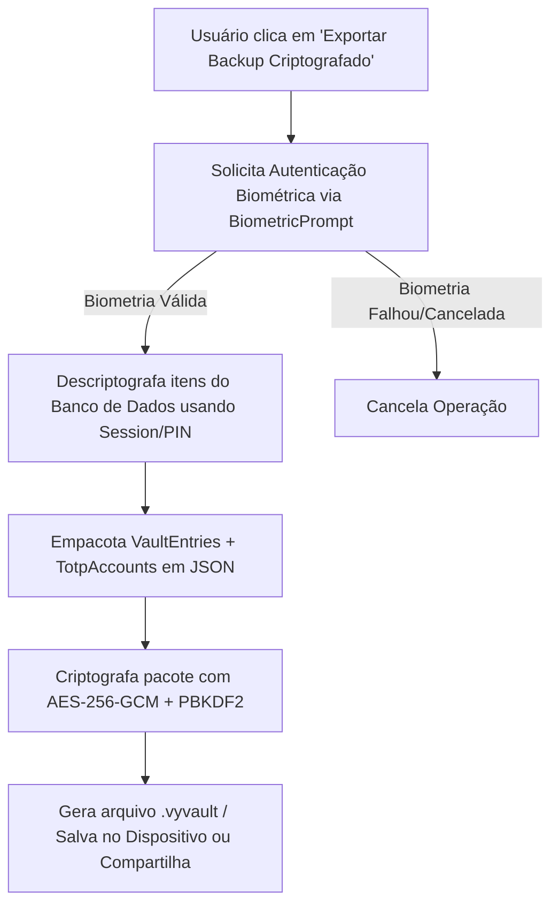

# Adição de 2 Novos Recursos: Cofre de Senhas + Autenticador TOTP

## Descrição

Adicionar dois novos módulos ao VY Swiss Knife:

1. **Password Vault** — Clone do Bitwarden: cofre de senhas local criptografado com AES-256
2. **TOTP Authenticator** — Clone do Google/Microsoft/Oracle Auth: gerador de códigos TOTP (RFC 6238) com suporte a QR Code

Ambos os dados ficam **100% locais** no dispositivo, protegidos com biometria e/ou PIN mestre.

---

## Open Questions

> [!IMPORTANT]
> **Criptografia do Cofre**: A criptografia será feita com AES-256-GCM usando a chave derivada de um PIN mestre definido pelo usuário na primeira vez que abre o cofre. Confirma essa abordagem?

> [!IMPORTANT]
> **Biometria**: Deseja proteção biométrica (impressão digital / face) para desbloquear o cofre e o autenticador? Ou só PIN?

> [!NOTE]
> **Importação**: Deseja suporte a importar senhas de um CSV (formato Bitwarden export)? E importar contas TOTP via QR Code scan? (O QR Scanner já existe no projeto)

---

## Proposed Changes

### 1. Dados (Room Database)

#### [NEW] `VaultEntry.kt` — Entidade de senha no cofre
- Campos: `id`, `title`, `username`, `encryptedPassword`, `url`, `notes`, `category`, `isFavorite`, `createdAt`, `updatedAt`
- DAO com operações CRUD + busca por texto + filtro por categoria

#### [NEW] `TotpAccount.kt` — Entidade de conta TOTP
- Campos: `id`, `issuer`, `accountName`, `encryptedSecret`, `algorithm`, `digits`, `period`, `iconColor`
- DAO com operações CRUD + reordenação

#### [MODIFY] [AppDatabase.kt](file:///projetos/apps-mobile/android/VYKnifeSwiss/app/src/main/java/com/example/data/AppDatabase.kt)
- Adicionar `VaultEntry::class` e `TotpAccount::class` às entidades
- Incrementar `version` de 4 para 5

---

### 2. Utilitários de Segurança

#### [NEW] `VaultCrypto.kt`
- Encriptação AES-256-GCM com chave derivada de PIN via PBKDF2WithHmacSHA256
- Funções: `encrypt(plaintext, pin)`, `decrypt(ciphertext, pin)`, `hashPin(pin)`
- Armazenamento da salt no SharedPreferences (não criptografado)

#### [NEW] `TotpGenerator.kt`
- Implementação RFC 6238 pura em Kotlin (sem libs externas)
- Suporte a TOTP com SHA-1/SHA-256/SHA-512
- Função `generateTotp(secret, period, digits, algorithm)` e `timeRemaining(period)`
- Decode de Base32 nativo

---

### 3. Telas

#### [NEW] `PasswordVaultScreen.kt`
**Fluxo de segurança:**
- Se nenhum PIN configurado → tela de criação de PIN (com confirmação)
- Se PIN configurado → tela de desbloqueio com PIN (ou biometria se disponível)
- Após autenticado → vault desbloqueado com timeout de 5 min

**UI do Vault:**
- TopAppBar com busca e ícone de lock
- Tabs: "Todas", "Favoritos", "Logins", "Cartões", "Notas seguras"
- Lista de entradas com avatar inicial, título, username e ícone de copiar senha
- FAB para adicionar nova entrada
- Dialog de add/edit: título, username, senha (com gerador aleatório e toggle show/hide), URL, notas, categoria, favorito
- Gerador de senhas com controle de tamanho e opções (maiúsculas, números, símbolos)
- Long press → opções (Copiar senha, Copiar usuário, Editar, Excluir)

#### [NEW] `TotpAuthenticatorScreen.kt`
**UI:**
- Lista de contas com:
  - Ícone colorido com iniciais
  - Nome do emissor (ex: "GitHub") e conta (ex: "user@email.com")
  - Código TOTP de 6 dígitos (formatado como `123 456`)
  - Barra de progresso circular indicando tempo restante (30s refresh)
  - Botão de copiar código
- FAB para adicionar conta
- Dialog de adição: manual (issuer, account, secret key) ou scan de QR Code
- Suporte a otpauth:// URI via QR scan
- Drag-to-reorder

---

### 4. Navegação

#### [MODIFY] [Screen.kt](file:///projetos/apps-mobile/android/VYKnifeSwiss/app/src/main/java/com/example/ui/navigation/Screen.kt)
```kotlin
object PasswordVault : Screen("password_vault")
object TotpAuthenticator : Screen("totp_authenticator")
```

#### [MODIFY] [MainActivity.kt](file:///projetos/apps-mobile/android/VYKnifeSwiss/app/src/main/java/com/example/MainActivity.kt)
- Adicionar composable para `Screen.PasswordVault` e `Screen.TotpAuthenticator`

#### [MODIFY] [DashboardScreen.kt](file:///projetos/apps-mobile/android/VYKnifeSwiss/app/src/main/java/com/example/ui/screens/DashboardScreen.kt)
- Adicionar as duas ferramentas na categoria **Segurança & Privacidade** (nova categoria) ou na de utilitários
- Ícones: `Icons.Default.Lock` para o Vault, `Icons.Default.Phonelink` para o TOTP

---

## Verificação

### Testes manuais
- Criar PIN, adicionar senha, fechar o app, reabrir e verificar desbloqueio com PIN correto/incorreto
- Adicionar conta TOTP manualmente, verificar código gerado e countdown
- Adicionar conta TOTP via QR Code scan
- Copiar senha do vault para o clipboard
- Usar gerador de senhas e confirmar complexidade
- Testar timeout do vault (lock automático após 5 min)


# Plano de Implementação: Exportação e Backup Criptografado com Biometria (PIN / Digital / Face ID)

## Visão Geral

Este plano adiciona a funcionalidade de **Exportação e Importação Criptografada com Proteção Biométrica** para o **Cofre de Senhas** e para o **Autenticador TOTP**.

O arquivo exportado (`.vyvault` ou `.json.enc`) conterá todas as senhas e chaves 2FA protegidas por **criptografia AES-256-GCM**. A operação de exportação e importação só é liberada após **autenticação biométrica bem-sucedida** (Impressão digital / Face ID) do usuário.

---

## 🔒 Como Funciona o Fluxo de Segurança Biométrica



---

## 📝 Alterações Propostas

### 1. Modelo de Dados de Backup (`com.example.data`)

#### [NEW] [VaultBackupPayload.kt](file:///projetos/apps-mobile/android/VYKnifeSwiss/app/src/main/java/com/example/data/VaultBackupPayload.kt)
- Data class contendo a estrutura unificada de exportação:
  - `version`: Int (versão do formato de backup)
  - `exportedAt`: Long (timestamp)
  - `vaultEntries`: List<VaultEntry>
  - `totpAccounts`: List<TotpAccount>

---

### 2. Utilitário de Backup Biométrico (`com.example.utils`)

#### [MODIFY] [VaultCrypto.kt](file:///projetos/apps-mobile/android/VYKnifeSwiss/app/src/main/java/com/example/utils/VaultCrypto.kt)
- Adicionar função `createEncryptedBackupPayload(entries, totpAccounts, pin)`
- Adicionar função `parseEncryptedBackupPayload(encryptedJson, pin)`
- Suporte a geração de arquivo `.vyvault` contendo header + IV + Salt + Ciphertext.

---

### 3. Interface de Usuário (UI)

#### [MODIFY] [PasswordVaultScreen.kt](file:///projetos/apps-mobile/android/VYKnifeSwiss/app/src/main/java/com/example/ui/screens/PasswordVaultScreen.kt)
- Atualizar dialog de exportação para incluir a opção **"Backup Criptografado (.vyvault) com Biometria"**.
- Ao clicar em exportar, chama `BiometricPrompt`. Após sucesso, gera o arquivo e abre o seletor para salvar no dispositivo ou compartilhar.
- Atualizar dialog de importação para suportar leitura do arquivo `.vyvault` mediante biometria + PIN.

#### [MODIFY] [TotpAuthenticatorScreen.kt](file:///projetos/apps-mobile/android/VYKnifeSwiss/app/src/main/java/com/example/ui/screens/TotpAuthenticatorScreen.kt)
- Adicionar botões de **Exportar / Importar Backup Criptografado** no TopAppBar do Autenticador TOTP com validação biométrica.

---

## 🧪 Plano de Verificação

### Testes Manuais
1. **Exportação Biométrica**:
   - Acessar o Cofre ou Autenticador.
   - Selecionar "Exportar Backup Criptografado".
   - Confirmar com impressão digital / Face ID.
   - Verificar se o arquivo `.vyvault` gerado está totalmente cifrado (ininteligível em editor de texto plano).
2. **Importação Biométrica**:
   - Simular restauração em um cofre limpo.
   - Selecionar o arquivo `.vyvault`, autenticar com biometria + PIN.
   - Confirmar a restauração correta de todas as senhas e chaves TOTP (com geração funcional dos códigos 2FA).

# Plano de Implementação: Suporte a QR Code otpauth-migration:// no Leitor de QR

Ajustar o leitor de QR Code (`QrCodeScreen.kt`) para identificar QR Codes com a URI `otpauth-migration://` (lote de contas 2FA do Google Authenticator) e apresentar visualmente as opções para o usuário abrir/importar no próprio app (Autenticador 2FA) ou abrir no padrão do sistema (Intent Android).

## Alterações Propostas

### Componente: QR Code Reader & Scanner (`QrCodeScreen.kt`)

#### [MODIFY] [QrCodeScreen.kt](file:///projetos/apps-mobile/android/VYKnifeSwiss/app/src/main/java/com/example/ui/screens/QrCodeScreen.kt)
- Adicionar parâmetro `navController: NavController? = null` (ou callback `onNavigateToTotp: (() -> Unit)? = null`) na assinatura da `QrCodeScreen`.
- Melhorar a leitura de galeria/prints utilizando `QrSnapshotDecoder.decodeSnapshotUri` para suportar capturas de tela em alta resolução e modo escuro.
- Adicionar detecção especial para URIs iniciadas em `otpauth-migration://` e `otpauth://`.
- Quando um QR Code `otpauth-migration://` for escaneado:
  - Decodificar e exibir resumo das contas encontradas via `TotpGenerator.parseGoogleAuthMigrationUri(scannedText)`.
  - Exibir card proeminente com 2 opções claras de ação:
    1. **"Abrir no Próprio App" (Importar no 2FA)**: Grava as contas 2FA diretamente no banco de dados local (`TotpDao`) via Coroutine e navega para a tela `TotpAuthenticatorScreen`.
    2. **"Abrir no Padrão do Sistema"**: Dispara uma `Intent(Intent.ACTION_VIEW, Uri.parse(scannedText))` para que o Android abra no app externo associado (ex: Google Authenticator), tratando `ActivityNotFoundException` caso nenhum app esteja instalado.

### Componente: Navegação (`MainActivity.kt`)

#### [MODIFY] [MainActivity.kt](file:///projetos/apps-mobile/android/VYKnifeSwiss/app/src/main/java/com/example/MainActivity.kt)
- Atualizar a rota `Screen.QrCode.route` no `NavHost` para repassar o `navController` para `QrCodeScreen(navController = navController)`.

---

## Plano de Verificação

### Teste de Compilação
- Compilar o projeto Android para validar sintaxe Kotlin e Jetpack Compose.

### Verificação Manual / Funcional
- Testar escaneamento de URIs `otpauth-migration://` via câmera e galeria.
- Verificar se o card de resultado detecta corretamente o lote e exibe o número de contas 2FA.
- Testar o botão "Abrir no Próprio App": confirmar importação no banco de dados e navegação para a tela do Autenticador 2FA.
- Testar o botão "Abrir no Padrão do Sistema": verificar disparo do Intent do sistema.


# Compartilhamento e Transmissão de Backup via Chat Local

## 1. Funcionamento entre Aparelhos (PINs / Biometrias Diferentes)
- **Biometria Local**: A biometria (digital/Face ID) é usada apenas como gatilho de autorização no próprio dispositivo.
- **PIN/Senha do Backup**: O backup criptografado (`.vyvault`) é gerado usando criptografia **AES-256-GCM + PBKDF2** a partir da senha/PIN digitado no momento da exportação.
- **Portabilidade**: Funciona perfeitamente em aparelhos novos ou que possuam PINs/biometrias completamente diferentes. Ao importar no novo aparelho, o usuário autoriza com a biometria local e informa o PIN/Senha que definiu na exportação.

---

## 2. Nova Opção de Transmissão via Chat Local (Wi-Fi / Rede)
Adicionada a opção **"Chat Local (Wi-Fi)"** nos diálogos de exportação do **Cofre de Senhas** e do **Autenticador 2FA**:
- **`PasswordVaultScreen.kt`** e **`TotpAuthenticatorScreen.kt`**:
  - Ao escolher o formato **🔐 Criptografado (.vyvault)**, foram disponibilizadas 3 ações:
    1. **Copiar .vyvault para Transferência** (Copia o hash criptografado para a área de transferência).
    2. **Compartilhar** (Abre a folha de compartilhamento nativa do Android — WhatsApp, Telegram, Google Drive, Bluetooth, Quick Share, Email).
    3. **Chat Local (Wi-Fi)** (Transfere o payload criptografado diretamente para a caixa do Chat Local da rede, redirecionando o usuário para selecionar o dispositivo de destino na LAN).
- **`MainActivity.kt`**:
  - Conectadas as rotas do Cofre e do Autenticador ao redirecionador do `LocalChatScreen`.


Viewed TotpAuthenticatorScreen.kt:78-99
Viewed VaultCrypto.kt:1-150
Viewed TotpAccount.kt:1-43
Viewed VaultEntry.kt:1-47
Searched for "encryptedSecret"

# Plano de Implementação — Criptografia em Repouso dos Segredos TOTP (Android KeyStore AES-256-GCM)

Adicionar uma camada de criptografia transparente em repouso (*Encryption at Rest*) para os segredos das contas do Autenticador TOTP 2FA, utilizando chaves mantidas no **Android KeyStore** (hardware-backed TEE/StrongBox) com algoritmo **AES-256-GCM**.

## User Review Required

> [!IMPORTANT]
> - **Proteção Física dos Arquivos**: Mesmo se um atacante realizar a extração física do banco de dados SQLite do aplicativo (`vy_swiss_database.db`), os segredos TOTP estarão criptografados com uma chave mantida no hardware do dispositivo (*Android KeyStore*), que não pode ser exportada do aparelho.
> - **Compatibilidade e Transparência**: O processo é transparente para o usuário. Contas salvas anteriormente sem criptografia no banco de dados serão migradas automaticamente para a forma criptografada na primeira leitura.
> - **Backup/Exportação**: No fluxo de exportação de backup criptografado (`.vyvault`), o segredo descriptografado continuará sendo protegido pela chave derivada do PIN Mestre.

## Proposed Changes

### Core Security Utility

#### [NEW] [TotpSecretCrypto.kt](file:///projetos/apps-mobile/android/VYKnifeSwiss/app/src/main/java/com/example/utils/TotpSecretCrypto.kt)
- Criar a classe utilitária `TotpSecretCrypto`:
  - Gerenciar chave simétrica AES-256 no `AndroidKeyStore`.
  - Método `encryptSecret(rawSecret: String): String` -> Retorna string no formato `ENC_KS_v1:<Base64(IV + Ciphertext)>`.
  - Método `decryptSecret(storedSecret: String): String` -> Descriptografa segredos com prefixo `ENC_KS_v1:`. Caso a string seja legada (sem o prefixo), retorna o texto legado diretamente.

### TOTP UI & Data Layer Integration

#### [MODIFY] [TotpAuthenticatorScreen.kt](file:///projetos/apps-mobile/android/VYKnifeSwiss/app/src/main/java/com/example/ui/screens/TotpAuthenticatorScreen.kt)
- Ao gerar o código de 6 dígitos no card `TotpCard`: descriptografar o segredo com `TotpSecretCrypto.decryptSecret(account.encryptedSecret)`.
- Ao cadastrar/editar/importar contas (via QR code, screenshot do Google Auth ou formulário manual): criptografar o segredo com `TotpSecretCrypto.encryptSecret(secret)` antes de persisitir via `totpDao.insert()` ou `totpDao.update()`.
- No diálogo de edição: exibir o segredo limpo/descriptografado no campo de texto para visualização e alteração do usuário.

#### [MODIFY] [QrCodeScreen.kt](file:///projetos/apps-mobile/android/VYKnifeSwiss/app/src/main/java/com/example/ui/screens/QrCodeScreen.kt)
- Ao salvar nova conta 2FA capturada pelo leitor de QR Code: utilizar `TotpSecretCrypto.encryptSecret(...)` antes de salvar.

#### [MODIFY] [VaultBackupPayload.kt](file:///projetos/apps-mobile/android/VYKnifeSwiss/app/src/main/java/com/example/data/VaultBackupPayload.kt)
- Ao importar contas do cofre ou arquivos de backup: criptografar o segredo do TOTP antes de salvar no banco de dados.

## Verification Plan

### Automated Tests
- Executar `./gradlew assembleDebug` para confirmar compilação limpa.

### Manual Verification
1. Adicionar uma nova conta 2FA via formulário manual ou QR Code.
2. Confirmar no banco de dados que o campo `encryptedSecret` contém o prefixo `ENC_KS_v1:` e a carga AES-256-GCM.
3. Confirmar que o código de 6 dígitos continua sendo calculado e atualizado corretamente a cada 30 segundos.
4. Exportar e restaurar backup criptografado para garantir interoperabilidade.


# Plano de Implementação — Compartilhamento Seguro de Contas TOTP (QR Code & .vyvault Selecionado)

Implementar o compartilhamento individual e por seleção de contas TOTP 2FA com todas as **boas práticas de segurança**: autenticação biométrica obrigatória antes da exibição, criptografia AES-256-GCM para pacotes `.vyvault` e proteção de dados sensíveis.

## User Review Required

> [!IMPORTANT]
> - **Autenticação Biométrica Obrigatória**: A exibição de um QR Code individual ou a exportação de contas selecionadas só será liberada após confirmação por digital/Face ID/senha do celular (`promptBio`).
> - **Seleção de Contas na Exportação**: No diálogo de exportação, o usuário poderá marcar/desmarcar contas específicas de 2FA (e entradas do cofre) em vez de ser obrigado a exportar todo o banco de dados.
> - **Criptografia Portátil**: Exportações individuais ou em lote via arquivo `.vyvault` continuarão protegidas por criptografia simétrica AES-256-GCM com PIN numérico definido pelo usuário.

## Proposed Changes

### UI & Component Layer

#### [MODIFY] [TotpAuthenticatorScreen.kt](file:///projetos/apps-mobile/android/VYKnifeSwiss/app/src/main/java/com/example/ui/screens/TotpAuthenticatorScreen.kt)
- **Menu do Card da Conta (`TotpCard`)**:
  - Adicionar opção **"Exibir QR Code"**: solicita biometria (`promptBio`) e abre o diálogo seguro `TotpSingleQrDialog`.
  - Adicionar opção **"Exportar esta conta (.vyvault)"**: solicita biometria (`promptBio`) e permite gerar o payload criptografado apenas dessa conta específica.
- **Novo Diálogo `TotpSingleQrDialog`**:
  - Renderizar o QR Code da URI `otpauth://totp/...` usando ZXing (`QRCodeWriter`).
  - Exibir o QR Code em alta definição em tema escuro/neon, com botões para "Copiar URI otpauth://" e "Compartilhar .vyvault".
- **Melhoria no Diálogo de Exportação (`TotpExportDialog`)**:
  - Adicionar lista interativa de seleção (Checkboxes) permitindo escolher quais contas 2FA e credenciais serão incluídas no arquivo exportado.
  - Adicionar atalho "Selecionar Todas / Desmarcar Todas".

## Verification Plan

### Automated Tests
- Executar `./gradlew assembleDebug` para garantir compilação sem erros.

### Manual Verification
1. No Autenticador 2FA, clicar no menu (3 pontinhos) de uma conta individual.
2. Clicar em "Exibir QR Code": verificar se o aplicativo exige a biometria/senha do celular antes de mostrar o QR Code.
3. Confirmar que o QR Code gerado é lido corretamente por outro aplicativo 2FA.
4. Abrir a exportação de backup e desmarcar algumas contas: verificar se o arquivo `.vyvault` gerado contém apenas as contas selecionadas ao restaurar em outro dispositivo.


# Segurança dos dados fisicos

Aqui está uma análise detalhada da segurança do **Cofre de Senhas** e do **Autenticador TOTP** caso alguém roube o aparelho e consiga acessar os arquivos internos do aplicativo:

---

### 1. Cofre de Senhas (Password Vault) 🛡️ — **MUITO SEGURO**
- **Como as senhas são gravadas:** O app utiliza criptografia de nível militar **AES-256-GCM** com derivação de chave **PBKDF2** (100.000 iterações com Salt aleatório).
- **Se o criminoso extrair os arquivos do celular:**
  - As senhas estão totalmente **criptografadas**.
  - O PIN Mestre **NÃO** fica salvo em texto puro em nenhum arquivo.
  - **Resultado:** Sem a senha/PIN Mestre que está na sua cabeça, o invasor **não consegue descriptografar** as senhas do cofre, mesmo tendo acesso completo aos arquivos do banco de dados.

---

### 2. Autenticador TOTP 2FA 🔑 — **PROTEÇÃO DA INTERFACE (SANDBOX DO ANDROID)**
- **Proteção por Biometria (Interface):** A biometria que ativamos impede que o bandido abra o app na sua frente ou com o celular desbloqueado na rua para ver os códigos de 6 dígitos que mudam a cada 30 segundos.
- **Se o criminoso extrair os arquivos internos (Root / Extração Física):**
  - As chaves secretas 2FA ficam armazenadas no banco de dados interno do app (`/data/data/com.example/databases/vy_swiss_database.db`).
  - O sistema Android protege essa pasta através de *Sandbox* (outros apps comuns não conseguem ler).
  - Porém, se o invasor utilizar ferramentas avançadas de perícia/root no aparelho, as chaves secretas (Base32) do TOTP estão gravadas diretamente no banco local do app.

---

### 💡 Resumo e Comparativo

| Recurso | Proteção contra abertura na tela do celular | Proteção contra extração física de arquivos (Root/Hackers) |
| :--- | :--- | :--- |
| **Cofre de Senhas** | Exige PIN ou Biometria | **Protegido por AES-256 com PIN Mestre** (Impossível ler sem o PIN) |
| **Autenticador TOTP** | **Protegido por Biometria do Celular** | Protegido pelo Sandbox do Android (podemos criptografar com o PIN no futuro se desejar) |

---
